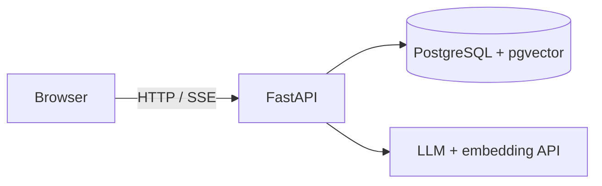

# Ask your PDF

Chat with your PDFs. Upload documents to a project, wait for ingestion, and ask questions answered by an OpenAI-compatible LLM using your documents as context, streamed in real time.


## Features

- **Per-project isolation:** documents and chat sessions never mix between projects.
- **Async PDF ingestion:** upload (max 20 MB, 10 documents per project), then extract, chunk and embed in the background with live status (`pending` → `uploaded` → `processing` → `ready` / `failed`).
- **RAG chat:** vector similarity search over the project's chunks, with persistent multi-session history.
- **Streaming answers** over Server-Sent Events.
- **JWT authentication** with Argon2 password hashing.

## Tech stack

FastAPI · PostgreSQL + pgvector/VectorScale (HNSW, cosine, 1536-dim) · SQLAlchemy + Alembic · PyMuPDF · any OpenAI-compatible LLM/embedding API · vanilla JS frontend · Docker Compose · `uv` · pytest

## How it works



1. **Ingest:** a PDF is extracted with PyMuPDF, chunked, embedded, and stored. If anything fails, partial embeddings are removed and the document is marked `failed`.
2. **Chat:** the question is embedded, the closest project chunks are retrieved, and they are sent with recent history to the LLM. The answer streams back and is saved.

## Quick start

Requires Docker Compose v2 and an OpenAI-compatible LLM/embedding service.

```bash
cp .env.example .env            # or create it from the block below
docker compose up --build
docker compose exec app alembic upgrade head
```

Open http://localhost:7000 (API at http://localhost:8000, docs at `/docs`).

## Configuration

`.env` in the project root (never commit it):

```dotenv
APP_PORT=8000
ENVIRONMENT=DEV
LOG_LEVEL=INFO

POSTGRES_USER=app
POSTGRES_PASSWORD=change-me
POSTGRES_DB=simple_rag
POSTGRES_HOST=postgres          # localhost when running without Docker
POSTGRES_PORT=5432

JWT_SECRET=replace-with-a-long-random-secret
JWT_ALGORITHM=HS256
ACCESS_TOKEN_EXPIRE_MINUTES=90

LLM_BASE_URL=http://host.docker.internal:20128/v1
LLM_API_KEY=replace-with-your-api-key
LLM_MODEL_NAME=gemini-combo
EMBEDDING_MODEL_NAME=gemini-embedding-001   # must return 1536-dim vectors
```

CORS allows only `http://localhost:7000` and `http://127.0.0.1:7000`.

## Running without Docker

Requires Python 3.13+, PostgreSQL with the vector extension, and `uv`.

```bash
uv sync
uv run alembic upgrade head
uv run fastapi dev app/main.py --host 0.0.0.0 --port 8000
python -m http.server 7000 --directory frontend   # serve over HTTP, not file://
```

## API

Base path `/api/v1`. All endpoints except register and login need `Authorization: Bearer <token>`.

| Area | Endpoints |
| --- | --- |
| Auth | `POST /auth/register`, `POST /auth/login` (form data), `GET /auth/me` |
| Projects | `POST/GET /projects`, `GET/PATCH/DELETE /projects/{id}` |
| Documents | `GET/POST /projects/{id}/documents` (upload field `pdf_document`), `DELETE /projects/{id}/documents/{doc_id}` |
| Chat | `POST /chat/creating`, `GET /projects/{id}/chats`, `GET/POST/PATCH/DELETE /chat/{chat_id}` |

`POST /chat/{chat_id}` streams SSE events:

```text
data: {"type":"status","content":"searching_documents"}
data: {"type":"token","content":"The"}
data: {"type":"done"}
```

Errors arrive as `{"type":"error","content":"..."}`. Full interactive docs are at `/docs`.

## Project structure

```text
app/
  routers/    auth, project (projects + documents), chat
  services/   document ingestion, retrieval, chat
  helpers/    PDF processing and chunking
  models.py   SQLAlchemy models
  schemas/    Pydantic schemas
  core/       settings
alembic/      migrations
frontend/     static SPA
tests/        pytest suite
```

## Testing

```bash
uv run pytest
```

Needs a PostgreSQL database with the vector extension (configured via the variables in `tests/conftest.py`).

## Troubleshooting

- **"Failed to fetch":** serve the frontend from `localhost:7000` (not `file://`) and make sure the backend is on port 8000.
- **Chat disabled:** at least one document in the project must be `ready`.
- **Embedding errors:** check `LLM_BASE_URL`, `LLM_API_KEY`, and that the embedding model returns 1536-dim vectors.
- **DB connection errors:** `POSTGRES_HOST` is `postgres` under Compose, `localhost` otherwise.

## Before deploying

Replace all secrets, use HTTPS, restrict CORS to your real frontend origin, run a production ASGI setup, review upload and rate limits, and keep PostgreSQL and the LLM endpoint off the public internet.